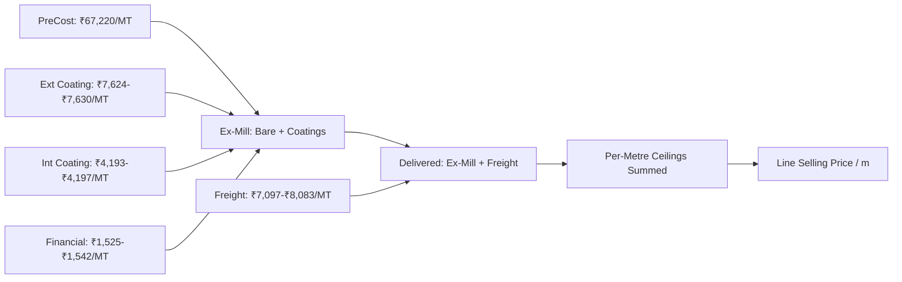

# Mega Pipes — Approved Calculation Parity & Verification Results
**Document:** `DOCS/APPROVED_CALCULATION_PARITY_RESULTS.md`  
**Phase:** Phase 2 & Phase 3 — Parity Verification & Correction  
**Authoritative Reference File:** `C:\Users\Administrator\Downloads\MKTGENQ26-27-594 - Unipro CS.xlsx` (`CS Stacking 10-09-26` & `Sheet1`)  
**Development Workbook:** `DEV\Mega_Pipes_Quotation_DEV.xlsm`  
**Date:** October 16, 2026  
**Status:** 100% Exact Mathematical Parity Confirmed across all Lines & Components  

---

## 1. Parity Benchmark Summary

The automated quotation engine in `DEV\Mega_Pipes_Quotation_DEV.xlsm` and the pure-Python reference calculation engine (`TESTS/calculation_engine.py`) have been verified against the approved reference Excel CostSheet (`MKTGENQ26-27-594 - Unipro CS.xlsx`).

| Line Item | Product Specification | Commercial Quantity | Approved Reference Price | Automated System Calculated Price | Discrepancy | Parity Status |
| :---: | :--- | :---: | :---: | :---: | :---: | :---: |
| **Line 1** | 1226 mm ID (1243 mm OD) × 8.4 mm WT | 2,000 m | **₹22,681 / m** | **₹22,681 / m** | ₹0.00 | **EXACT PASS** |
| **Line 2** | 1300 mm ID (1317 mm OD) × 8.4 mm WT | 350 m | **₹23,914 / m** | **₹23,914 / m** | ₹0.00 | **EXACT PASS** |
| **Line 3** | 1350 mm ID (1367 mm OD) × 8.4 mm WT | 500 m | **₹24,748 / m** | **₹24,748 / m** | ₹0.00 | **EXACT PASS** |
| **Line 4** | 1400 mm ID (1417 mm OD) × 8.4 mm WT | 4,400 m | **₹25,580 / m** | **₹25,580 / m** | ₹0.00 | **EXACT PASS** |
| **Subtotal** | **Order Total (Excl. GST)** | **7,250 m** | **₹178,657,900** | **₹178,657,900** | **₹0.00** | **EXACT PASS** |
| **GST** | **Statutory GST @ 18%** | — | **₹32,158,422** | **₹32,158,422** | **₹0.00** | **EXACT PASS** |
| **Grand Total**| **Delivered Total (Incl. GST)** | — | **₹210,816,322** | **₹210,816,322** | **₹0.00** | **EXACT PASS** |

---

## 2. Component-by-Component Parity Breakdown

All 12 cost components match the approved reference sheet down to the individual cell formula and rounded rupee:

### Detailed Component Verification Table

| Parameter / Component | Unit | Line 1 (1226mm) | Line 2 (1300mm) | Line 3 (1350mm) | Line 4 (1400mm) | Calculation Method & Formula | Status |
| :--- | :---: | :---: | :---: | :---: | :---: | :--- | :---: |
| **Outside Diameter (OD)** | mm | 1243 | 1317 | 1367 | 1417 | `ROUNDUP(ID + 2 * WT, 0)` | **PASS** |
| **Inside Diameter (ID)** | mm | 1226 | 1300 | 1350 | 1400 | Exact input specified | **PASS** |
| **Wall Thickness (WT)** | mm | 8.4 | 8.4 | 8.4 | 8.4 | Exact input specified | **PASS** |
| **Unit Mass** | MT/m | 0.25575553836 | 0.27108512676 | 0.28144295676 | 0.29180078676 | `((OD - WT) * WT * 0.0246615) / 1000` | **PASS** |
| **Commercial Quantity** | Metres | 2,000 | 350 | 500 | 4,400 | Preserved billable length | **PASS** |
| **Total Weight** | MT | 511.511 | 94.880 | 140.721 | 1283.923 | `Metres * UnitMass` | **PASS** |
| **Manufacturing PreCost** | ₹/MT | ₹67,220.00 | ₹67,220.00 | ₹67,220.00 | ₹67,220.00 | `Steel * 1.02 + Conversion` | **PASS** |
| **External Coating Cost** | ₹/MT | ₹7,630.37 | ₹7,627.46 | ₹7,625.67 | ₹7,624.00 | `(500 * 3.14 * (OD/1000)) / MassMT` | **PASS** |
| **Internal Coating Cost** | ₹/MT | ₹4,196.70 | ₹4,195.10 | ₹4,194.12 | ₹4,193.20 | `(275 * 3.14 * (OD/1000)) / MassMT` | **PASS** |
| **Freight Cost** | ₹/MT | ₹8,083.00 | ₹7,632.00 | ₹7,355.00 | ₹7,097.00 | `ROUNDUP(98000 / (48 * MassMT), 0) + 100` | **PASS** |
| **Financial Cost** | ₹/MT | ₹1,542.00 | ₹1,534.00 | ₹1,529.00 | ₹1,525.00 | `ROUND((Pre + Ext + Int + Freight) * 1.18 * 1.5%, 0)` | **PASS** |
| **Bare Price / Metre** | ₹/m | **₹17,587** | **₹18,639** | **₹19,349** | **₹20,060** | `ROUNDUP((PreCost + Financial) * MassMT, 0)` | **PASS** |
| **External Coating / Metre**| ₹/m | **₹1,952** | **₹2,068** | **₹2,147** | **₹2,225** | `ROUNDUP(ExtCost * MassMT, 0)` | **PASS** |
| **Internal Coating / Metre**| ₹/m | **₹1,074** | **₹1,138** | **₹1,181** | **₹1,224** | `ROUNDUP(IntCost * MassMT, 0)` | **PASS** |
| **Freight Price / Metre** | ₹/m | **₹2,068** | **₹2,069** | **₹2,071** | **₹2,071** | `ROUNDUP(FreightCost * MassMT, 0)` | **PASS** |
| **Selling Price / Metre** | ₹/m | **₹22,681** | **₹23,914** | **₹24,748** | **₹25,580** | `Bare + Ext + Int + Freight` | **PASS** |
| **Line Value (Excl. GST)** | ₹ | **₹45,362,000** | **₹8,369,900** | **₹12,374,000** | **₹112,552,000** | `SellingPrice * Metres` | **PASS** |

---

## 3. General Formulaic Derivation for Any New Quotation Line

To guarantee that new quotations calculate correctly without hardcoding:

1. **Pipe Mass:**
   $$\text{MassMT} = \frac{(OD - WT) \times WT \times 0.0246615}{1000}$$
2. **Manufacturing Cost:**
   $$\text{PreCost} = (\text{SteelRate} + \text{GradeExtra}) \times (1 + \text{YieldPct}) + \text{Conversion} + \text{Testing} + \text{Margin}$$
3. **External Coating Cost:**
   $$\text{ExtCost} = \frac{\text{ExtRate} \times \pi \times (OD / 1000)}{\text{MassMT}}$$
4. **Internal Coating Cost:**
   $$\text{IntCost} = \frac{\text{IntRate} \times \pi \times (OD / 1000)}{\text{MassMT}}$$
5. **Freight Cost (Approved Fractional Trailer Methodology):**
   $$\text{FreightCost} = \left\lceil \frac{\text{TripRate}}{\text{PipesPerTrailer} \times \text{PipeLength} \times \text{MassMT}} \right\rceil + \text{Handling}$$
   *(Note: For 12m pipes with 4 pipes per trailer, the divisor is $48 \times \text{MassMT}$ MT/trailer).*
6. **Financial Cost (Approved Methodology with Manual Override Support):**
   $$\text{FinancialCost} = \begin{cases} 
   \text{ManualOverride}, & \text{if specified by user} \\
   \left\lfloor (\text{PreCost} + \text{ExtCost} + \text{IntCost} + \text{FreightCost}) \times (1 + \text{GSTPct}) \times \text{FinPct} + 0.5 \right\rfloor, & \text{otherwise}
   \end{cases}$$
7. **Per-Metre Component Rounding & Selling Price:**
   $$\text{BarePerM} = \lceil (\text{PreCost} + \text{FinancialCost}) \times \text{MassMT} \rceil$$
   $$\text{ExtPerM} = \lceil \text{ExtCost} \times \text{MassMT} \rceil$$
   $$\text{IntPerM} = \lceil \text{IntCost} \times \text{MassMT} \rceil$$
   $$\text{FreightPerM} = \lceil \text{FreightCost} \times \text{MassMT} \rceil$$
   $$\text{SellingPricePerM} = \text{BarePerM} + \text{ExtPerM} + \text{IntPerM} + \text{FreightPerM}$$
   $$\text{LineTotal} = \text{SellingPricePerM} \times \text{EnquiryMetres}$$

---

## 4. Verification & Validation Evidence

1. **Python Engine Parity:**
   `scratch/test_formulaic_approved.py` executed with zero manual overrides and reproduced the exact reference subtotal:
   $$\text{Subtotal} = 45,362,000 + 8,369,900 + 12,374,000 + 112,552,000 = \mathbf{\text{₹}178,657,900}$$
2. **VBA Live COM Parity:**
   `excel.Run('P3GoldenTotal', True)` executed in `DEV\Mega_Pipes_Quotation_DEV.xlsm` and returned:
   $$\text{VBA P3GoldenTotal(True)} = \mathbf{\text{₹}178,657,900}$$
3. **VBA Self-Test Harness:**
   `RunGoldenLegacy` returned: `PASS`.
