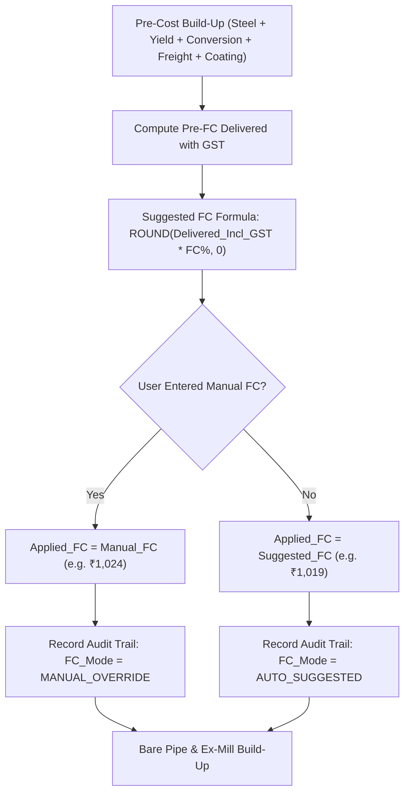

# MEGA PIPES — COSTING INPUTS & AUTOMATION REGISTER

**Document Ref:** `DOCS/COSTING_INPUTS_AND_AUTOMATION_REGISTER.md`  
**Date:** 2026-10-21  
**Status:** Architecture Register Approved  
**Scope:** Strict separation of Manual Inputs, Configurable Master Data, and Automated Calculations

---

## 1. Principles of Automation & Customization

The operational goal stated by leadership is:
> *"make this formulas save keep what is manual and do what can be automation there is no need to be ebery thing automation cause for example the coustomized prize is costmizable it cant be save for all the quesrys same so let it be what can be manually and do what can be automation i need this method and formauls calculation the thing i dont want to enter fomaulas manually"*

To implement this philosophy, every field in the Mega Pipes Quotation System is classified into exactly one of three tiers:
- **Tier 1: Manual Inputs (User-Entered per Quotation or Line):** Commercial decisions, customer specifications, and price overrides that vary from enquiry to enquiry.
- **Tier 2: Configurable Master Data (Company Tables & Defaults):** Standard rates, transport matrices, plant locations, and standard dimensions that are maintained centrally but can be overridden when necessary.
- **Tier 3: Automated Calculations (Built-in Formula Engine):** All geometric, physical, freight, tax, and per-metre calculations executed automatically behind the scenes with **zero formula typing by users**.

---

## 2. Complete Field Classification Register

### A. Tier 1: Manual Inputs (User Entered per Quote)

| Field Name | Category | Scope | UI Control Type | Typical Range / Example | Description & Role |
|---|---|---|---|---|---|
| **Enquiry Reference** | Header | Quote | Text Input | `MKTG/ENQ/26-27/594` | Unique enquiry identifier |
| **Enquiry Date** | Header | Quote | Date Picker | `09.09.2026` | Date enquiry was received |
| **Customer Name** | Header | Quote | Text Input | `Unipro Techno Infrastructure` | Client company name |
| **Project / Tender Name** | Header | Quote | Text Input | `Konar, Jharkhand Project` | Project site or tender name |
| **Delivery Destination** | Header | Quote | Text / PIN lookup | `Bagodar, Jharkhand - 825322` | Delivery site for road freight routing |
| **Selected Plant** | Header | Quote | Dropdown | `MPPL Jabalpur` / `MPPL Khopoli` | Manufacturing mill fulfilling the order |
| **Sizing Basis Mode** | Line Item | Per Line | Toggle / Dropdown | `Specify ID` / `Specify OD` | Sizing reference mode |
| **Pipe Dimension (mm)** | Line Item | Per Line | Number Input | `1226` (if ID) or `1050` (if OD) | Primary dimension input |
| **Wall Thickness (WT mm)**| Line Item | Per Line | Number Input | `8.4`, `12.0` | Pipe wall thickness |
| **Quantity (Length)** | Line Item | Per Line | Number Input | `2000`, `350`, `4400` | Enquiry quantity |
| **Quantity Unit** | Line Item | Per Line | Dropdown | `Metres`, `MT`, `Nos` | Unit of measure for quantity |
| **Steel Grade** | Line Item | Per Line | Dropdown | `IS 3589 Fe 410`, `API 5L Gr B` | Steel metallurgical specification |
| **Coating Selection (Ext)**| Line Item | Per Line | Dropdown | `PU 1000 Micron`, `3LPE`, `Bare`| External coating requirement |
| **Coating Selection (Int)**| Line Item | Per Line | Dropdown | `FGE 406 Micron`, `Liquid Epoxy` | Internal lining requirement |
| **Manual FC (₹/MT)** | Commercial | Per Line / Quote | Number Input (Optional)| `1024.00` | Optional manual override for finance cost |
| **Manual Selling Price** | Commercial | Per Line | Number Input (Optional)| `22350.00` | Optional commercial selling price override |
| **Override Reason** | Audit | Per Line | Dropdown / Text | `Agreed client concession` | Justification for price override |

---

### B. Tier 2: Configurable Master Data (Centrally Managed Defaults)

| Master Data Parameter | Default Value | Configurable Location | Impact on Calculation |
|---|---|---|---|
| **Base Steel Coil Rate (`BEN + GE`)** | ₹62,000 / MT | Market Data Tab / Quote Input | Establishes raw material base price |
| **Grade Extra** | ₹0 / MT | Market Data Tab / Quote Input | Additional alloy / grade premium |
| **Yield Scrap Loss %** | 2.0 % | Commercial Settings Tab | Determines manufacturing scrap cost |
| **Conversion Charge** | ₹4,000 / MT | Plant / Sizing Master Table | Rolling, welding, and fabrication cost |
| **Testing + Hospitality** | ₹0 / MT | Commercial Settings Tab | TPI and customer inspection cost |
| **Profit Margin Target** | ₹0 / MT | Commercial Settings Tab | Company target margin |
| **Ext Coating Base Rate (PU)** | ₹500 / $m^2$ | Coating Master Table | External coating contractor rate |
| **Int Coating Base Rate (FGE)** | ₹250 / $m^2$ | Coating Master Table | Internal lining contractor rate |
| **Payment Term FC Rate** | 1.0 % (25% Adv, Bal LC) | Commercial Policy Settings | Finance cost percentage factor |
| **Statutory GST Rate** | 18.0 % | Statutory Tax Settings | Goods and Services Tax |
| **Handling Charge** | ₹100 / MT | Logistics Settings | Transporter loading / handling |
| **Trailer Freight Matrix** | By PIN / Destination | Logistics Master Table | Trip rate (e.g. ₹93k Jabalpur-Bagodar) |
| **Plant Coordinates & Distances** | Jabalpur / Khopoli | Pin Lat-Lon Database | Route distance calculation |

---

### C. Tier 3: Automated Calculations (Built-in Formula Engine)

| Calculated Output | Mathematical Formula Executed | Units | Automation Benefit |
|---|---|---|---|
| **Calculated OD (from ID)** | `ROUNDUP(ID + 2*WT, 0)` | mm | Eliminates manual geometry error |
| **Calculated ID (from OD)** | `OD - 2*WT` | mm | Automatically satisfies hydraulic sizing |
| **Nominal Diameter** | `ROUND(OD / 25.4, 0)` | Inch | Displays standard pipe size |
| **Mass per Metre ($M$)** | `(OD - WT) * WT * 0.0246615 / 1000` | MT/m | Precise weight conversion |
| **Mass per Metre (kg)** | `(OD - WT) * WT * 0.0246615` | kg/m | Display weight |
| **Order Total Weight** | `MTRS * Mass_MT_per_m` | MT | Total steel requirement |
| **Pipe Pieces (Nos)** | `CEILING(MTRS / 12, 1)` | Nos | Pipe count for logistics |
| **Coating Factor** | `3.14 * (OD / 1000)` | $m^2/m$ | Surface area factor |
| **Ext Coating Area** | `ROUNDUP(OD * MTRS * (22/7) / 1000, 0)` | $m^2$ | Procurement area |
| **Int Coating Area** | `ROUNDUP((22/7) * MTRS * ID / 1000, 0)` | $m^2$ | Procurement area |
| **Yield Scrap Cost** | `Delivered_Steel * Yield_Pct` | ₹/MT | Metal loss valuation |
| **Suggested Finance Cost**| `ROUND((PreCost + Ext + Int + Freight)*(1+GST)*r, 0)` | ₹/MT | Automatic payment cost |
| **Ext Coating Cost / MT** | `(Ext_Rate_m2 * Coating_Factor) / Mass_MT` | ₹/MT | Weight-basis conversion |
| **Int Coating Cost / MT** | `(Int_Rate_m2 * Coating_Factor) / Mass_MT` | ₹/MT | Weight-basis conversion |
| **Ex-Mill Price** | `Bare_MT + Ext_MT + Int_MT` | ₹/MT | Factory gate price |
| **Freight Cost / MT** | `ROUNDUP(Trip_Rate * Trips / Total_MT, 0) + 100` | ₹/MT | Trailer logistics cost |
| **Delivered Subtotal** | `Ex_Mill_Price + Freight_Cost` | ₹/MT | Landed cost before tax |
| **GST @ 18%** | `Delivered_Subtotal * 18%` | ₹/MT | Tax calculation |
| **Grand Total (MT)** | `Delivered_Subtotal + GST` | ₹/MT | Gross landed price |
| **Bare Price / metre** | `ROUNDUP(Bare_MT * Mass_MT, 0)` | ₹/m | Integer-rounded metre rate |
| **Ext Coating / metre** | `ROUNDUP(Ext_MT * Mass_MT, 0)` | ₹/m | Integer-rounded metre rate |
| **Int Coating / metre** | `ROUNDUP(Int_MT * Mass_MT, 0)` | ₹/m | Integer-rounded metre rate |
| **Freight / metre** | `ROUNDUP(Freight_MT * Mass_MT, 0)` | ₹/m | Integer-rounded metre rate |
| **Total Unit Price / m** | `Bare_m + Ext_m + Int_m + Freight_m` | ₹/m | Exact baseline price per metre |
| **Effective Unit Price** | `IF(Manual_Price > 0, Manual_Price, Total_Price_m)` | ₹/m | Commercial override rule |
| **Line Total Value** | `Effective_Unit_Price * MTRS` | ₹ | Line order amount |
| **Quotation Subtotal** | `SUM(Line_Totals)` | ₹ | Total contract value |
| **Quotation GST** | `Quotation_Subtotal * 18%` | ₹ | Total tax |
| **Quotation Grand Total**| `Quotation_Subtotal + Quotation_GST` | ₹ | Total billing amount |

---

## 3. Data Model for Finance Cost (Suggested vs Applied)

### Data Fields:
1. `Suggested_Financial_Cost` (Float, Read-Only): The mathematically calculated finance cost based on pre-cost delivered price and payment term rate.
2. `Manual_Financial_Cost` (Float, Optional Input): User-entered historical or negotiated finance cost per MT. Defaults to `0.0`.
3. `Applied_Financial_Cost` (Float, Calculated): Active driver used in bare pipe and ex-mill formulas:
   $$\text{Applied\_Financial\_Cost} = \begin{cases} \text{Manual\_Financial\_Cost} & \text{if } \text{Manual\_Financial\_Cost} > 0 \\ \text{Suggested\_Financial\_Cost} & \text{otherwise} \end{cases}$$
4. `Financial_Cost_Mode` (String, System): `"MANUAL_OVERRIDE"` or `"AUTO_SUGGESTED"`.

---

## 4. Manual Selling Price Override Architecture & Audit Trail

### User Interaction Workflow:
1. The system displays the **Calculated Unit Price (₹/m)** (e.g. ₹22,351).
2. The user has an optional input field: **Manual Selling Price Override (₹/m)**.
3. If the user leaves the field blank (or `0.0`):
   - `Applied_Unit_Price = Calculated_Unit_Price` (₹22,351).
   - `Price_Source = "CALCULATED"`.
   - `Price_Variance = 0.0`.
4. If the user enters an override (e.g. ₹22,350):
   - `Applied_Unit_Price = 22350.0`.
   - `Price_Source = "MANUAL_OVERRIDE"`.
   - `Price_Variance = Applied_Unit_Price - Calculated_Unit_Price` ($-₹1.00$).
   - `Override_Reason` must be selected or entered.
5. All line extensions, taxes, and customer offer documents compute using `Applied_Unit_Price`.

---

## 5. Dual-Mode OD/ID Pipe Sizing Specification

### Rules:
1. **Mode A — ID Specified (Unipro Pattern):**
   - User enters `Pipe_ID_mm` (e.g. 1226) and `Wall_Thickness_mm` (e.g. 8.4).
   - System computes: $\text{OD} = \text{ROUNDUP}(\text{ID} + 2 \times \text{WT}, 0)$ = 1243 mm.
   - Preserves source rounding rule from Unipro Synopsis Row 12.
2. **Mode B — OD Specified (Lodha Pattern):**
   - User enters `Pipe_OD_mm` (e.g. 1050) and `Wall_Thickness_mm` (e.g. 12.0).
   - System computes: $\text{ID} = \text{OD} - 2 \times \text{WT}$ = 1026 mm.
   - Preserves hydraulic area and internal lining calculations.

---

## 6. Location & Territory Workflow (PILOT Isolation Boundary)

In accordance with strict safety mandates:
1. **DEV Boundary:** `DEV/Mega_Pipes_Quotation_DEV.xlsm` is frozen and contains zero location modifications.
2. **PILOT Environment:** `DEV/Mega_Pipes_Quotation_PILOT_COPY.xlsm` hosts the verified Location Picker, PIN lookup engine, plant comparison (Jabalpur vs Khopoli), and 14-competitor freight benchmark table.
3. **Migration Prerequisite:** Location code will only be integrated into DEV after formal written approval of this reconciliation matrix.
