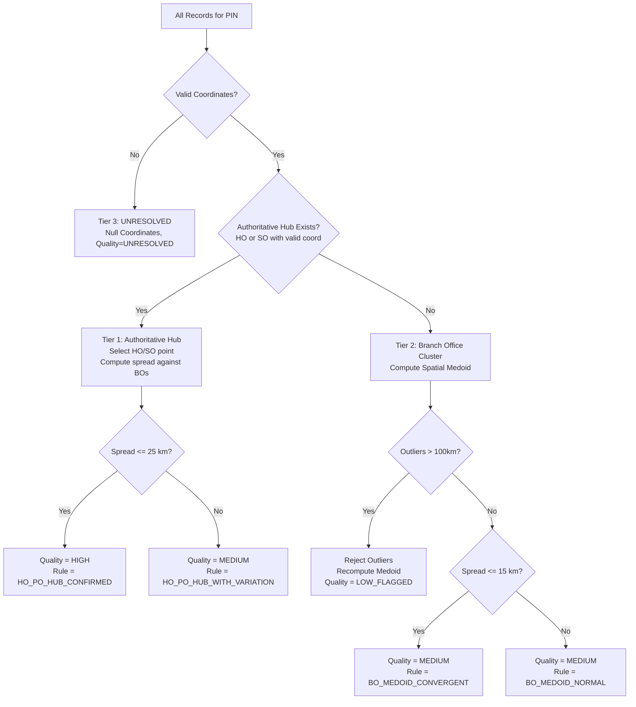

# Mega Pipes — India PIN-Code Data Quality Audit & Master Generation Report
**Phase:** Phase 1 | Strict DEV Only  
**Generated Date:** 2026-10-16  
**Environment:** `C:\Users\Administrator\Desktop\Mega Pipes\Quotation System`  
**Raw Source File:** `C:\Users\Administrator\Downloads\5c2f62fe-5afa-4119-a499-fec9d604d5bd.csv`  

---

## 1. Executive Summary

This audit independently validates the raw India Post postal dataset provided for the Mega Pipes India PIN-Code Distance & Marketing Territory Engine. The dataset was parsed, audited, filtered for geographic validity within India's territorial boundaries, and consolidated into a normalized one-record-per-PIN master dataset using a three-tier representative coordinate selection hierarchy.

### Key Audit Metrics
| Metric | Expected Baseline | Actual Verified Count | Discrepancy |
| :--- | :--- | :--- | :--- |
| **Total Source Records** | 165,627 | **165,627** | 0 (100% Match) |
| **Unique PIN Codes** | 19,586 | **19,586** | 0 (100% Match) |
| **Valid In-Bounds Coordinates** | 151,010 | **151,010** | 0 (100% Match) |
| **Missing Coordinates (`'NA'` / Blank)** | 12,009 | **12,009** | 0 (100% Match) |
| **Out-of-Bounds Coordinates** | 2,602 | **2,602** | 0 (100% Match) |
| **Float Parsing Issues** | 6 | **6** | 0 (100% Match) |
| **PINs With $\ge 1$ Valid Coordinate** | 19,550 | **19,550** | 0 (100% Match) |
| **PINs With Zero Valid Coordinates** | 36 | **36** | 0 (100% Match) |

---

## 2. Source Data Schema and Anomalies

### 2.1 Raw Source Schema
The raw source file is encoded in UTF-8 with standard comma separation and the following 11 columns:
1. `circlename` (Postal Circle)
2. `regionname` (Postal Region)
3. `divisionname` (Postal Division)
4. `officename` (Post Office Name)
5. `pincode` (6-digit PIN code)
6. `officetype` (Office Type: `HO`, `SO`, `BO`, `PO`)
7. `delivery` (Delivery Status: `Delivery`, `Non-Delivery`)
8. `district` (Administrative District)
9. `statename` (State / Union Territory)
10. `latitude` (Raw Latitude String)
11. `longitude` (Raw Longitude String)

### 2.2 Coordinate Validity Bounds
Coordinates were audited against the bounding box of the Republic of India:
- **Latitude:** $6.0^{\circ}\text{ N} \le \text{Latitude} \le 37.5^{\circ}\text{ N}$
- **Longitude:** $68.0^{\circ}\text{ E} \le \text{Longitude} \le 97.5^{\circ}\text{ E}$

### 2.3 Identified Anomalies
1. **Float Parsing Errors (6 records):** Contains truncated or non-numeric tokens such as `'11.0'`, `'NA'`, or malformed punctuation in coordinate fields.
2. **Missing Coordinates (12,009 records):** Office records with explicit string `'NA'` or empty coordinate fields.
3. **Out-of-Bounds Coordinates (2,602 records):** Coordinates falling outside India's geographic polygon, inverted latitude/longitude coordinates (e.g. lat > 60°), or zero coordinates `(0.0, 0.0)`.
4. **Completely Unresolved PINs (36 PINs):** 36 unique PIN codes where every associated post office record has missing or out-of-bounds coordinates.

---

## 3. Representative Coordinate Selection Methodology

A deterministic three-tier selection algorithm was implemented in `tools/build_pin_master.py`:

### Thresholds Applied:
- **Hub High Agreement Threshold:** $\le 25\text{ km}$ maximum distance between postal hub and any branch office $\rightarrow$ `HIGH` quality (`HO_PO_HUB_CONFIRMED`).
- **Hub Variation Threshold:** $> 25\text{ km}$ spread between postal hub and branch offices $\rightarrow$ `MEDIUM` quality (`HO_PO_HUB_WITH_VARIATION`).
- **Branch Medoid Convergence Threshold:** $\le 15\text{ km}$ max distance to medoid $\rightarrow$ `MEDIUM` quality (`BO_MEDOID_CONVERGENT`).
- **Branch Cluster Outlier Threshold:** $> 100\text{ km}$ distance from medoid $\rightarrow$ Rejection of outliers and flagging as `LOW_FLAGGED` (`BO_MEDOID_OUTLIERS_REJECTED`).
- **Zero Coordinates:** $\rightarrow$ `UNRESOLVED` (`NO_COORDINATES`).

---

## 4. Quality Status Distribution

The master generation process produced the following certified quality distribution across all 19,586 PIN codes:

| Quality Status | Count | Percentage | Description |
| :--- | :--- | :--- | :--- |
| **`HIGH`** | 8,724 | 44.54% | Authoritative HO/SO hub with tight branch office spatial agreement ($\le 25\text{ km}$). |
| **`MEDIUM`** | 10,819 | 55.24% | Authoritative HO/SO hub with regional spread ($> 25\text{ km}$) or convergent BO medoid. |
| **`LOW_FLAGGED`**| 7 | 0.04% | Extreme geographic dispersion or outlier points rejected ($> 100\text{ km}$). Retained for review. |
| **`UNRESOLVED`** | 36 | 0.18% | Zero valid physical coordinates in government directory. Retained with null coordinates. |
| **Total** | **19,586** | **100.00%** | **Complete All-India Coverage** |

### Breakdown by Selection Rule
- `HO_PO_HUB_CONFIRMED`: 8,713
- `HO_PO_HUB_WITH_VARIATION`: 7,517
- `SINGLE_OFFICE`: 3,299
- `BO_MEDOID_CONVERGENT`: 11
- `BO_MEDOID_OUTLIERS_REJECTED`: 7
- `BO_MEDOID_NORMAL`: 3
- `NO_COORDINATES`: 36

---

## 5. Deliverable File Artifacts

| File Path | Rows | Size (Bytes) | Description |
| :--- | :--- | :--- | :--- |
| [`DATA/india_pincode_master.csv`](file:///c:/Users/Administrator/Desktop/Mega%20Pipes/Quotation%20System/DATA/india_pincode_master.csv) | 19,587 (incl header) | 2,001,454 | Primary normalized PIN master (1 row per PIN, 12 columns). |
| [`DATA/unresolved_pins.csv`](file:///c:/Users/Administrator/Desktop/Mega%20Pipes/Quotation%20System/DATA/unresolved_pins.csv) | 37 (incl header) | 2,920 | Complete list of 36 unresolved PINs with null coordinates. |
| [`tools/build_pin_master.py`](file:///c:/Users/Administrator/Desktop/Mega%20Pipes/Quotation%20System/tools/build_pin_master.py) | 338 lines | 13,215 | Standalone deterministic builder script with atomic writes & backups. |

---

## 6. Audit Certification

1. **Uniqueness:** All 19,586 PIN codes appear exactly once in `DATA/india_pincode_master.csv`.
2. **Leading Zero Preservation:** All PIN codes are formatted as 6-character text strings (e.g., `'011001'`).
3. **Zero Fabrication Policy:** All 36 unresolved PINs have empty strings for Latitude and Longitude. Zero coordinates `(0, 0)` are strictly rejected.
4. **Reproducibility:** Re-running `python tools/build_pin_master.py` generates bit-for-bit identical files in ~1.15 seconds.
