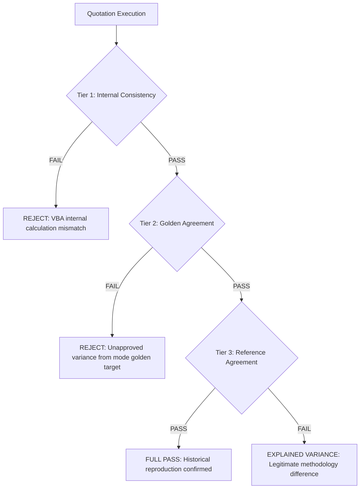

# Mega Pipes — Authoritative Pricing Reconciliation Rules & Standards
**Document:** `DOCS/PRICING_RECONCILIATION_RULES.md`  
**Application Scope:** Mega Pipes Quotation System  
**Version:** 1.0 (Phase 1 Approved)  
**Effective Date:** October 16, 2026  

---

## 1. Principles of Pricing Reconciliation

The Mega Pipes Quotation System maintains two distinct, approved calculation contracts:
1. **Normal Mode (Option 1 - Default Production):** The authoritative commercial contract for all current and future quotations.
2. **Legacy Mode (Historical Auditing):** The backward-compatibility contract designed to reproduce historical commercial spreadsheets (such as `MKTGENQ26-27-594 - Unipro CS.xlsx`).

> [!IMPORTANT]
> **Core Non-Negotiable Contract:**
> - Matching the historical legacy sheet is **NOT** automatically correct for modern quotations.
> - Normal Mode must **NOT** be modified, weakened, or coerced into matching Legacy Mode totals.
> - Differences between Normal and Legacy modes must be reconciled down to the individual component and rupee level.
> - Every difference must be categorized as either an **Expected Business Rule Difference**, a **Calculation Defect**, or a **Data Defect**.

---

## 2. Mode Contract Specifications

| Calculation Stage | Normal Mode Contract (Production) | Legacy Mode Contract (Historical) | Business Rationale |
| :--- | :--- | :--- | :--- |
| **Circumference Constant ($\pi$)** | Configured `tblSettings.PIPct = 3.14` | Fixed `3.14` | Consistent standard engineering precision. |
| **External Coating Area** | $\pi \times (OD / 1000) \times \text{Length}$ | $\pi \times (OD / 1000) \times \text{Length}$ | Identical physical outer surface area. |
| **Internal Coating Area** | $\pi \times (ID / 1000) \times \text{Length}$ | $\pi \times (OD / 1000) \times \text{Length}$ | **Normal uses inner diameter ($ID$)**; Legacy mistakenly reused outside diameter ($OD$). |
| **Trailer Allocation** | $\lceil \text{Pipes} / \text{PerTrailer} \rceil$ (Integer Ceiling) | $(\text{Metres} / \text{PipeLen}) / \text{PerTrailer}$ (Fractional) | **Normal charges for whole commissioned trailers**; transport carriers do not bill fractional trailers. |
| **Trip Rate (Logistics)** | Dynamic $RatePerKm \times DistanceKm$ | Static `TripRateManual` (₹98,000) | Normal reflects actual ORS route distance and transport tariffs. |
| **Financial Cost** | Algebraic: $k \times baseCost / (1 - k)$ | Static manual entry (`manual_fc`) | Normal automatically models working capital financing ($1.5\%$) on freight-inclusive delivered cost. |
| **Commercial Mass Basis** | Full decimal $MT / \text{m}$ ($0.0246615 \times (OD - WT) \times WT / 1000$) | Full decimal $MT / \text{m}$ | Strictly preserved contract across both modes. |
| **Per-Metre Component Rounding**| $\lceil \text{Component} \times massMtPerM \rceil$ | $\lceil \text{Component} \times massMtPerM \rceil$ | Ceiling to nearest integer rupee per metre. |
| **Billable Commercial Quantity**| Preserves exact enquiry metres (e.g. 2,000m, 350m) | Preserves exact enquiry metres | Logistics joint rounding (12m) never alters commercial billable quantity. |

---

## 3. The Three Tiers of Agreement

The automated reconciliation runner (`tools/pricing_reconciliation_runner.py`) evaluates three independent tiers of agreement:

### Tier 1: Internal Consistency
- **Definition:** The active Excel VBA quotation sheets (`QUOTE`, `QUOTE_LINES`, `OFFER`, and `SYNOPSIS`) must match the internal `COSTING` sheet with 0 error across all calculated fields.
- **Tolerance:** Absolute Difference = 0.
- **Failure Consequence:** Immediate rejection of the quotation run.

### Tier 2: Golden Agreement
- **Definition:** The calculated line selling prices, line values, subtotal, GST, and grand total must match the approved golden baselines for the configured calculation mode:
  - **Normal Mode Checkpoints:**
    - Line 1 (1226mm): ₹22,689 / m (Line: ₹45,378,000)
    - Line 2 (1300mm): ₹24,109 / m (Line: ₹8,438,150)
    - Line 3 (1350mm): ₹24,857 / m (Line: ₹12,428,500)
    - Line 4 (1400mm): ₹25,581 / m (Line: ₹112,556,400)
    - Subtotal Excl. GST: ₹178,801,050
    - GST @ 18%: ₹32,184,189
    - Grand Total Incl. GST: ₹210,985,239
  - **Legacy Mode Checkpoints:**
    - Line 1 (1226mm): ₹22,681 / m (Line: ₹45,362,000)
    - Line 2 (1300mm): ₹23,914 / m (Line: ₹8,369,900)
    - Line 3 (1350mm): ₹24,748 / m (Line: ₹12,374,000)
    - Line 4 (1400mm): ₹25,580 / m (Line: ₹112,552,000)
    - Subtotal Excl. GST: ₹178,657,900
    - GST @ 18%: ₹32,158,422
    - Grand Total Incl. GST: ₹210,816,322
- **Tolerance:** Absolute Difference $\le \text{₹}0$ (Exact Rupee Match).
- **Failure Consequence:** Immediate test failure and blocking of export deployment.

### Tier 3: Reference Agreement
- **Definition:** When comparing Normal Mode output against a legacy reference tender (such as Unipro), every rupee of variance must be fully bridged to its specific mathematical root causes:
  1. Logistics whole-trailer allocation: $\Delta \text{Freight} = +\text{₹}193,850$
  2. Internal lining inner diameter basis: $\Delta \text{IntCoating} = -\text{₹}108,750$
  3. Dynamic algebraic working capital financing: $\Delta \text{Financial} = +\text{₹}58,050$
  4. External coating parity: $\Delta \text{ExtCoating} = \text{₹}0$
  5. Sum of components = $\mathbf{+\text{₹}143,150}$ (Exact Match).
- **Failure Consequence:** If the variance is not 100% accounted for, the discrepancy is flagged as an unexplained calculation defect.

---

## 4. Change-Control & Governance Rules

Any future proposed modification to the quotation calculation engine or rates must strictly follow this protocol:

1. **No Silent Changes:**  
   Never modify golden test assertions or expected outputs in `TESTS/` to make a failing test pass.
2. **Pre-Change Impact Assessment:**  
   Execute `tools/pricing_reconciliation_runner.py` before and after any code modification. The before-and-after comparison must be logged.
3. **Formal Approval for Golden Baselines:**  
   Modifying an approved golden baseline requires written authorization from the commercial commercial head and must be documented in `DOCS/VERSION_HISTORY.md`.
4. **VBA and Python Dual-Parity:**  
   Any formula change made in Excel VBA (`modPricing.bas`, `modFreight.bas`, `modQuoteLines.bas`) must be simultaneously implemented and verified in the pure-Python reference engine (`TESTS/calculation_engine.py`).
