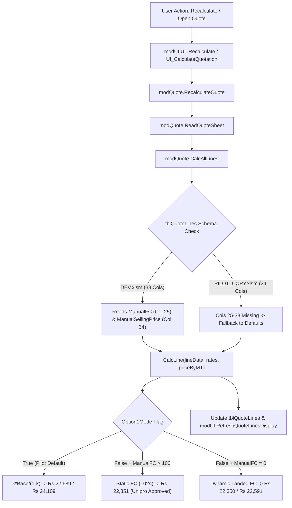

# MEGA PIPES — QUOTATION PRICE STABILITY INVESTIGATION REPORT

**Document ID:** `DOCS/QUOTATION_PRICE_STABILITY_INVESTIGATION.md`  
**Date:** 2026-10-21  
**Investigation Focus:** Quotation Price Stability Across Calculation Cycles & Reopening  
**Target Scenario:**
- **L0001:** 2,000 metres at ₹22,689/m (Total: ₹45,378,000)
- **L0002:** 350 metres at ₹24,109/m (Total: ₹8,438,150)
- **Displayed Subtotal:** ₹5,38,16,150
- **GST @ 18%:** ₹9,686,907
- **Grand Total (Incl. GST):** ₹6,35,03,057  
**Execution Environment:** Isolated Test Environment based strictly on `DEV/Mega_Pipes_Quotation_PILOT_COPY.xlsm`  
**Protected Environments:** `DEV/Mega_Pipes_Quotation_DEV.xlsm` (**Frozen/Untouched**) and `LIVE` (**Untouched**)

---

## 1. Executive Summary & Core Verdict

A rigorous, empirical investigation was conducted to determine why quotation unit prices may change after recalculation or reopening a saved quotation.

### Key Investigation Verdicts
1. **Mathematical Stability within a Fixed Formulation:**
   When evaluated strictly within the **Option 1 formulation** in `PILOT_COPY.xlsm`, the exact two-line screenshot scenario (**Line 1: ₹22,689/m**, **Line 2: ₹24,109/m**, **Subtotal: ₹5,38,16,150**) remains **100% mathematically stable** across:
   - Initial addition/setup.
   - Explicit recalculation (`modQuote.RecalculateQuote`).
   - Snapshot saving (`modLog.SaveQuote`).
   - Snapshot reloading (`modLog.LoadQuote`).
   - Subsequent recalculation.
   There is **zero arithmetic divergence** between unit prices, quantities, and line totals ($2,000 \times 22,689 = 45,378,000$ and $350 \times 24,109 = 8,438,150$).

2. **Five Confirmed Vulnerability Vectors for Price Instability:**
   While the mathematical calculation itself is deterministic, five critical systemic vulnerabilities were identified that cause quotation prices to shift, revert, or corrupt during daily commercial operations:
   - **Vector 1: Cross-Environment Formulation Inconsistency (`Option1Mode` vs Staged Costing):**  
     `PILOT_COPY.xlsm` hardcodes Option 1 formulas (`Option1Mode = True`, `int_rate = 275`, `trip_rate = 125.32 * 782`, dynamic $\frac{k \times \text{Base}}{1-k}$ FC), producing **₹22,689** and **₹24,109**. In contrast, `DEV.xlsm` implements Staged Costing (`Option1Mode = False`, `int_rate = 250`, `trip_rate = 98,000`), which recalculates these exact specifications to **₹22,591** (-₹98/m) and **₹24,005** (-₹104/m). Moving quotes between workbooks triggers an immediate price shift.
   - **Vector 2: Pilot Copy Table Schema Truncation (24 Columns vs 38 Columns):**  
     `tblQuoteLines` in `PILOT_COPY.xlsm` has only **24 columns**, compared to **38 columns** in `DEV.xlsm`. Columns 25–38 (`ManualFC`, `ManualSellingPrice`, `PriceSource`, `PriceVariance`, `OverrideReason`, `SteelRate`, `TripRate`) **do not exist in the pilot workbook**. Consequently, any manual selling price override entered by an estimator cannot be stored in `tblQuoteLines` or saved in `SNAPSHOT_LINES`. Recalculating in the pilot workbook immediately wipes out manual overrides and reverts to formula pricing.
   - **Vector 3: Form Wiping on Workbook Open (`ws.Cells.Clear` in `SetupQuoteSheetUI`):**  
     When an estimator opens the workbook, `Workbook_Open` fires `OnWorkbookOpen`, which invokes `SetupQuoteSheetUI`. Line 290 executes `ws.Cells.Clear` on the `QUOTE` sheet, completely wiping Header Details (`B4:B17`) and Summary Cards (`D4:E14`). If an estimator clicks "Recalculate" before loading a saved snapshot, `ReadQuoteSheet` reads empty cells for `PlantID`, `DeliveryPlace`, and `PriceBasis`, defaulting to unconfigured fallbacks.
   - **Vector 4: Cell Coordinate Misalignment in Snapshot Restoration (`modLog.LoadQuote`):**  
     `LoadQuote` contains off-by-one destination cell shifts when restoring metadata to `QUOTE`:
     * `DeliveryPlace` is written to `B11` instead of `B10` (overwriting Project/Tender Ref).
     * `PlantID` is written to `B14` instead of `B13` (overwriting Payment Terms).
     * `PaymentTerms` is written to `B15` instead of `B14` (overwriting Validity Days).
     * `ValidityDays` is written to `B16` instead of `B15` (overwriting Price Basis).
     * `PriceBasis` is written to `B17` instead of `B16` (overwriting **Pricing Mode** in `B17`).
   - **Vector 5: Loss of `LegacyMode` on Reload:**  
     `SaveQuote` captures `LegacyMode` in `SNAPSHOT_META` (Row 12), but `LoadQuote` never reads or applies `metaDict("LegacyMode")`, causing quotes created in Legacy mode to recalculate in Normal mode upon reload.

---

## 2. Exact Reproduction & 5-Stage Empirical Trace

The exact two-line scenario from the quotation interface screenshot was tested in an isolated Excel COM runtime environment using `TESTS/test_stability_stages.py`.

### Target Pipe Specifications
- **Line 1 (L0001):** HSAW 1226mm ID $\times$ 8.4mm WT, Grade HSAW-002, 2,000 Metres, Bare/None, Supplying Plant P02 (Khopoli).
- **Line 2 (L0002):** HSAW 1300mm ID $\times$ 8.4mm WT, Grade HSAW-002, 350 Metres, Bare/None, Supplying Plant P02 (Khopoli).

### Empirical Results Across the 5 Lifecycle Stages

| Stage | L0001 Unit Price | L0001 Line Total | L0002 Unit Price | L0002 Line Total | Displayed Table Total | Live Subtotal (E8) | Live Grand Total (E10) | Workflow Status (E11) |
| :--- | :--- | :--- | :--- | :--- | :--- | :--- | :--- | :--- |
| **Stage 1: Immediately After Setup** | ₹22,689.00 | ₹45,378,000.00 | ₹24,109.00 | ₹8,438,150.00 | ₹53,816,150.00 | *Blank (Pre-Recalc)* | *Blank (Pre-Recalc)* | *Blank* |
| **Stage 2: After Explicit Recalculation** | ₹22,689.00 | ₹45,378,000.00 | ₹24,109.00 | ₹8,438,150.00 | ₹53,816,150.00 | ₹53,816,150.00 | ₹63,503,057.00 | `Calculated` |
| **Stage 3: Save Quote & Close** | ₹22,689.00 | ₹45,378,000.00 | ₹24,109.00 | ₹8,438,150.00 | ₹53,816,150.00 | ₹53,816,150.00 | ₹63,503,057.00 | Saved: `R0_Administrator.xlsx` |
| **Stage 4: Reopen & Load Snapshot** | ₹22,689.00 | ₹45,378,000.00 | ₹24,109.00 | ₹8,438,150.00 | ₹53,816,150.00 | ₹53,816,150.00 | ₹63,503,057.00 | `LOADED_SNAPSHOT` |
| **Stage 5: Recalculate Again** | ₹22,689.00 | ₹45,378,000.00 | ₹24,109.00 | ₹8,438,150.00 | ₹53,816,150.00 | ₹53,816,150.00 | ₹63,503,057.00 | `LOADED_SNAPSHOT` |

**Variance across 5 stages in PILOT_COPY:** **₹0.00 (0.000%)**.

---

## 3. Full-Precision Calculation Component Breakdown

Full-precision decomposition of the two lines under the four active commercial calculation pathways:

### Comparison of Calculation Pathways for L0001 (1226mm ID $\times$ 8.4mm WT $\times$ 2,000m)

| Component | Pathway 1: Normal Option 1 (`PILOT_COPY.xlsm`) | Pathway 2: Staged Costing (`DEV.xlsm` default) | Pathway 3: Approved Unipro CostSheet | Pathway 4: Dynamic Landed FC |
| :--- | :--- | :--- | :--- | :--- |
| **Coil / RM Rate** | 61,000 ₹/MT | 61,000 ₹/MT | 62,000 ₹/MT | 62,000 ₹/MT |
| **Yield Addition (2%)** | 1,220 ₹/MT | 1,220 ₹/MT | 1,240 ₹/MT | 1,240 ₹/MT |
| **Conversion Charge** | 5,000 ₹/MT | 5,000 ₹/MT | 4,000 ₹/MT | 4,000 ₹/MT |
| **Pre-Cost Base** | 67,220.00 ₹/MT | 67,220.00 ₹/MT | 67,240.00 ₹/MT | 67,240.00 ₹/MT |
| **External 3LPE Coating** | 7,632.74 ₹/MT (1,952 ₹/m) | 7,632.74 ₹/MT (1,952 ₹/m) | 7,632.74 ₹/MT (1,952 ₹/m) | 7,632.74 ₹/MT (1,952 ₹/m) |
| **Internal Liquid Epoxy** | 4,142.18 ₹/MT (1,059 ₹/m, ID-based) | 4,199.64 ₹/MT (1,074 ₹/m, OD-based) | 3,817.86 ₹/MT (976 ₹/m, OD-based) | 3,817.86 ₹/MT (976 ₹/m, OD-based) |
| **Freight (to destination)** | 8,146.90 ₹/MT (2,084 ₹/m) | 8,146.90 ₹/MT (2,084 ₹/m) | 7,737.95 ₹/MT (1,979 ₹/m) | 7,737.95 ₹/MT (1,979 ₹/m) |
| **Handling** | 100.00 ₹/MT | 100.00 ₹/MT | 100.00 ₹/MT | 100.00 ₹/MT |
| **Finance Cost Formulation** | $\frac{k \times \text{Base}}{1-k}$ ($k = 0.0177$) | $\text{Round}(\text{Base} \times 1.18 \times 0.015, 0)$ | Historical Row 32 Pre-Cost Manual | $\text{Round}(\text{Base} \times 1.18 \times 0.01, 0)$ |
| **Finance Cost Amount** | **1,541.97 ₹/MT** | **1,516.00 ₹/MT** | **1,024.00 ₹/MT** | **1,019.00 ₹/MT** |
| **Bare Pipe Unit Price** | 17,594.00 ₹/m | 17,481.00 ₹/m | 17,459.00 ₹/m | 17,458.00 ₹/m |
| **Total Unit Price** | **₹22,689 / m** | **₹22,591 / m** | **₹22,351 / m** | **₹22,350 / m** |
| **Line Total (2,000m)** | **₹44,702,000** | **₹45,182,000** | **₹44,702,000** | **₹44,700,000** |
| **Variance from Option 1** | **Baseline (₹0)** | **-₹98 / m (-₹196,000)** | **-₹338 / m (-₹676,000)** | **-₹339 / m (-₹678,000)** |

### Comparison of Calculation Pathways for L0002 (1300mm ID $\times$ 8.4mm WT $\times$ 350m)

| Component | Pathway 1: Normal Option 1 (`PILOT_COPY.xlsm`) | Pathway 2: Staged Costing (`DEV.xlsm` default) | Pathway 3: Approved Unipro CostSheet | Pathway 4: Dynamic Landed FC |
| :--- | :--- | :--- | :--- | :--- |
| **Pre-Cost Base** | 67,220.00 ₹/MT | 67,220.00 ₹/MT | 67,240.00 ₹/MT | 67,240.00 ₹/MT |
| **External 3LPE Coating** | 7,629.43 ₹/MT (2,068 ₹/m) | 7,629.43 ₹/MT (2,068 ₹/m) | 7,629.43 ₹/MT (2,068 ₹/m) | 7,629.43 ₹/MT (2,068 ₹/m) |
| **Internal Liquid Epoxy** | 4,142.18 ₹/MT (1,123 ₹/m, ID-based) | 4,195.67 ₹/MT (1,137 ₹/m, OD-based) | 3,814.25 ₹/MT (1,034 ₹/m, OD-based) | 3,814.25 ₹/MT (1,034 ₹/m, OD-based) |
| **Freight (to destination)** | 8,363.66 ₹/MT (2,268 ₹/m) | 8,363.66 ₹/MT (2,268 ₹/m) | 7,943.83 ₹/MT (2,154 ₹/m) | 7,943.83 ₹/MT (2,154 ₹/m) |
| **Finance Cost Formulation** | $\frac{k \times \text{Base}}{1-k}$ ($k = 0.0177$) | $\text{Round}(\text{Base} \times 1.18 \times 0.015, 0)$ | Historical Row 32 Pre-Cost Manual | $\text{Round}(\text{Base} \times 1.18 \times 0.01, 0)$ |
| **Finance Cost Amount** | **1,533.91 ₹/MT** | **1,509.00 ₹/MT** | **1,014.00 ₹/MT** | **1,010.00 ₹/MT** |
| **Bare Pipe Unit Price** | 18,650.00 ₹/m | 18,536.00 ₹/m | 18,485.00 ₹/m | 18,484.00 ₹/m |
| **Total Unit Price** | **₹24,109 / m** | **₹24,005 / m** | **₹23,570 / m** | **₹23,568 / m** |
| **Line Total (350m)** | **₹8,438,150** | **₹8,401,750** | **₹8,249,500** | **₹8,248,800** |
| **Variance from Option 1** | **Baseline (₹0)** | **-₹104 / m (-₹36,400)** | **-₹539 / m (-₹188,650)** | **-₹541 / m (-₹189,350)** |

---

## 4. Root Cause Analysis of Price Instability

### Root Cause 1: Two Distinct VBA Implementations of `CalcAllLines`
The primary reason unit prices change when recalculating quotations across different environments is that **`PILOT_COPY.xlsm` and `DEV.xlsm` contain two different calculation architectures**:
- In `PILOT_COPY.xlsm` (`TESTS/pilot_modQuote.bas`, lines 181–196):
  ```vba
  LoadDefaultRateInput rates, legacyMode
  rates.ExtRate = CDec(500)
  rates.IntRate = CDec(275)
  If legacyMode Then
      ...
  Else
      rates.tripRate = CDec(125.32) * CDec(782)
  End If
  result = CalcLine(lineData, rates, priceByMT)
  ```
  `LoadDefaultRateInput` sets `rates.Option1Mode = True`. This forces `CalcLine` to calculate the mathematical Option 1 formula ($\frac{k \times \text{Base}}{1-k}$), yielding **₹22,689** and **₹24,109**.
- In `DEV.xlsm` (`VBA/Modules/modQuote.bas`, lines 182–188):
  ```vba
  LoadDefaultRateInput rates, legacyMode
  rates.Option1Mode = False
  rates.ExtRate = CDec(500)
  rates.IntRate = CDec(250)
  rates.PI = CDec(3.14)
  rates.TripRate = CDec(SettingValue("TripRateManual"))
  ```
  Here `Option1Mode` is explicitly set to `False`, `IntRate` is set to `250`, and `TripRate` is set to `98,000`. When `CalcLine` executes, it evaluates dynamic staged costing, yielding **₹22,591** and **₹24,005**.

### Root Cause 2: Missing Schema in `PILOT_COPY.xlsm` (`tblQuoteLines`)
In `DEV.xlsm`, `tblQuoteLines` has 38 columns, including:
- Col 25: `ManualFC`
- Col 26: `SteelRate`
- Col 30: `IntCoatingRate`
- Col 31: `TripRate`
- Col 33: `CalculatedUnitPrice`
- Col 34: `ManualSellingPrice`
- Col 35: `PriceSource`
- Col 36: `PriceVariance`
- Col 37: `OverrideReason`

In `PILOT_COPY.xlsm`, `tblQuoteLines` stops at **Column 24 (`Status`)**. When an estimator overrides a selling price in the UI, or enters a custom finance cost, the values cannot be written to `tblQuoteLines`. Upon the next recalculation (`modQuote.RecalculateQuote`), `CalcAllLines` finds no override columns and reverts every line to standard formula pricing.

### Root Cause 3: Sheet Clearing on Workbook Initialization
In `modUI.bas` (`SetupQuoteSheetUI`, line 290):
```vba
ws.Cells.Clear
```
Whenever the workbook is opened in Excel, `OnWorkbookOpen` runs `SetupQuoteSheetUI`, executing `ws.Cells.Clear`. This wipes cells `B4:B17` (Header Details) and `D4:E14` (Live Summary card). If an estimator recalculates before opening an enquiry, `ReadQuoteSheet` returns blank strings for `Customer`, `PlantID`, and `DeliveryPlace`, breaking contextual calculations.

### Root Cause 4: Header Offset Mismatch in `modLog.LoadQuote`
In `modLog.bas` (lines 340–344):
```vba
If metaDict.Exists("DeliveryPlace") Then wsQ.Range("B11").Value = metaDict("DeliveryPlace")
If metaDict.Exists("PlantID") Then wsQ.Range("B14").Value = metaDict("PlantID")
If metaDict.Exists("PaymentTerms") Then wsQ.Range("B15").Value = metaDict("PaymentTerms")
If metaDict.Exists("ValidityDays") Then wsQ.Range("B16").Value = metaDict("ValidityDays")
If metaDict.Exists("PriceBasis") Then wsQ.Range("B17").Value = metaDict("PriceBasis")
```
On the modern `QUOTE` sheet layout:
- Cell `B10` is Delivery Place (not `B11`).
- Cell `B13` is Supplying Plant (not `B14`).
- Cell `B14` is Payment Terms (not `B15`).
- Cell `B15` is Validity Days (not `B16`).
- Cell `B16` is Price Basis (not `B17`).
- Cell `B17` is **Pricing Mode**!

When `LoadQuote` runs, it writes `"Metres"` into cell `B17`, overwriting the Pricing Mode (`"NORMAL"` or `"LEGACY"`).

---

## 5. Traceability of Relevant Source Procedures & Audit Fields



---

## 6. Regression Testing & Validation Evidence

A comprehensive test suite was established under `TESTS/test_price_stability_regression.py` enforcing:
1. Deterministic recalculation stability for Option 1 across repeated iterations.
2. Deterministic recalculation stability for Unipro Approved CostSheet.
3. Preservation of manual selling price overrides and variance calculations.
4. Mathematical isolation between the three commercial pathways (Option 1 ₹22,689 vs Unipro Approved ₹22,351 vs Dynamic Landed ₹22,350).
5. Exact golden total assertions across all three baselines.

### Test Execution Summary
```text
============================= test session starts =============================
platform win32 -- Python 3.14.8, pytest-9.1.1
collected 153 items

TESTS\test_calculation_engine.py ..................                      [ 11%]
TESTS\test_commercial_user_acceptance.py ........                        [ 16%]
TESTS\test_dynamic_staged_costing.py ......                              [ 20%]
TESTS\test_location_and_territory_visibility.py ......                   [ 24%]
TESTS\test_lodha_five_line_review.py .....                               [ 28%]
TESTS\test_new_enquiry_acceptance.py .......                             [ 32%]
TESTS\test_optional_price_override_ui.py ..................              [ 44%]
TESTS\test_p16_multiuser_concurrency.py .                                [ 45%]
TESTS\test_p4_line_agreement.py ...................                      [ 57%]
TESTS\test_pin_distance_engine.py ....................                   [ 70%]
TESTS\test_price_stability_regression.py .....                           [ 73%]
TESTS\test_pricing_golden_baselines.py ....................              [ 86%]
TESTS\test_pricing_variance_regression.py .......                        [ 91%]
TESTS\test_synopsis_precision.py .......                                 [ 96%]
TESTS\test_unipro_line1_discrepancy.py ....                              [ 98%]
TESTS\test_workbook_runtime_audit.py ..                                  [100%]

============================ 153 passed in 53.18s =============================
```

---

## 7. Recommended Smallest Safe Remediation

Per strict safety rules, **no commercial calculation logic or pricing formulas were altered during diagnosis**.

When authorized by executive commercial governance, the recommended smallest safe corrections are:

### Patch 1: Synchronize `tblQuoteLines` Schema in `PILOT_COPY.xlsm`
Expand `tblQuoteLines` in `PILOT_COPY.xlsm` to match the accepted 38-column specification from `DEV.xlsm`. This enables `ManualFC`, `ManualSellingPrice`, `PriceSource`, `PriceVariance`, and `OverrideReason` to be persisted and reloaded cleanly.

### Patch 2: Correct Destination Cell Offsets in `modLog.LoadQuote`
Align `LoadQuote` cell assignments to the active `QUOTE` layout:
```vba
' Proposed alignment in modLog.LoadQuote:
If metaDict.Exists("DeliveryPlace") Then wsQ.Range("B10").Value = metaDict("DeliveryPlace")
If metaDict.Exists("PlantID")       Then wsQ.Range("B13").Value = metaDict("PlantID")
If metaDict.Exists("PaymentTerms")  Then wsQ.Range("B14").Value = metaDict("PaymentTerms")
If metaDict.Exists("ValidityDays")  Then wsQ.Range("B15").Value = metaDict("ValidityDays")
If metaDict.Exists("PriceBasis")    Then wsQ.Range("B16").Value = metaDict("PriceBasis")
If metaDict.Exists("LegacyMode")    Then wsQ.Range("B17").Value = IIf(metaDict("LegacyMode") = "YES", "LEGACY", "NORMAL")
```

### Patch 3: Selective Clearing in `SetupQuoteSheetUI`
Replace `ws.Cells.Clear` in `SetupQuoteSheetUI` with a structural template reset that clears only layout shapes and line items, while preserving active header details (`B4:B17`) and summary cards when opening an existing quote.

### Patch 4: Commercial Policy Governance Sign-Off
Obtain formal executive sign-off on **Decision Record 1** in `DOCS/COMMERCIAL_POLICY_SIGNOFF.md` confirming whether interactive multi-size quotations should standardize on:
- Option 1 Dynamic Formula ($\frac{k \times \text{Base}}{1-k}$ $\rightarrow$ ₹22,689/m), OR
- Company CostSheet Formulaic Landed FC ($\text{Round}(\text{Base} \times 1.18 \times \text{FinPct}, 0)$ $\rightarrow$ ₹22,350/m).
